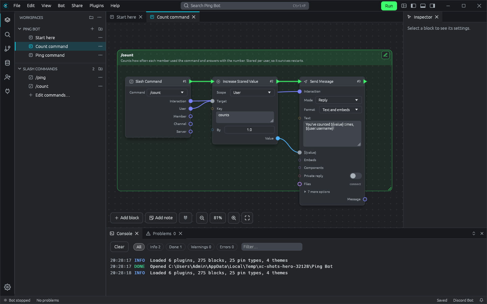

<div align="center">


# XC™ Circuit

**Build Discord and Fluxer bots by connecting blocks.**<br>
Wire events, actions and values on a canvas, run your bot with one click, and export it as a real Node.js project.

[**Download**](https://github.com/XCraftTM/XC-Circuit/releases/latest) ·
[**Website & docs**](https://xcrafttm.github.io/XC-Circuit/) ·
[Tutorials](https://xcrafttm.github.io/XC-Circuit/tutorials/) ·
[Plugin API](https://xcrafttm.github.io/XC-Circuit/api/) ·
[Changelog](CHANGELOG.md)


[](https://github.com/XCraftTM/XC-Circuit/releases/latest)



</div>

## Why XC Circuit

- 🧩 **Blocks, not boilerplate.** 248 blocks for messages, embeds and Components V2, pictures (welcome and rank cards), slash commands, buttons and menus, moderation, roles, music, stored data, databases (MariaDB, MySQL, PostgreSQL, SQLite, MongoDB), timers, web requests and more.
- ✍️ **JavaScript where you want it.** Every text takes `${…}`, with completion for what earlier blocks give. Run Code and Use Method reach everything discord.js can do.
- ▶️ **Run, watch, fix.** Press F5: blocks light up as they run, show how long they took, and hovering a wire shows the last value through it. Try Zones retry and catch errors.
- 📦 **A real bot to take anywhere.** Export a folder that runs with `node index.js`. Your token stays in your computer's password store.
- 🔌 **Everything is a plugin.** Blocks are JavaScript files; editor plugins add panels, commands, checks, even a desk pet. Install shared plugins from a zip.
- 🎨 **Comfortable.** Embed, Layout, Canvas and Slash Command Builders with live previews, notes, snap and align, a command palette, changeable shortcuts, themes, English and German.

## Get started

1. **[Download](https://github.com/XCraftTM/XC-Circuit/releases/latest)** the installer for your system:
   - Windows: `…-windows-x64-setup.exe` (or `arm64` for Snapdragon laptops)
   - Linux: `.AppImage`, `.deb` or `.rpm`

   [Which file?](https://xcrafttm.github.io/XC-Circuit/download)
2. Start it. The first start sets up Node.js for running bots.
3. Follow **[Your first bot](https://xcrafttm.github.io/XC-Circuit/tutorials/first-bot)**: a `/ping` command, running in 15 minutes. Or open a finished one: **Help › Open Example: DemoBot**, or a starter in **File › New Project**.

> [!NOTE]
> XC Circuit is in **Early Access**: it works and runs real bots, but expect rough edges. See the **[known issues](KNOWN_ISSUES.md)**, and please **report bugs** with Help › Report a Bug or on [GitHub](https://github.com/XCraftTM/XC-Circuit/issues/new/choose).

## Learn more

| | |
| --- | --- |
| 📘 [Tutorials](https://xcrafttm.github.io/XC-Circuit/tutorials/) | step by step, with pictures |
| 💡 [Explanations](https://xcrafttm.github.io/XC-Circuit/explanations/) | how bots, texts, data and plugins work |
| 🧭 [Everything the editor does](https://xcrafttm.github.io/XC-Circuit/explanations/editor-reference) | every feature, one line each |
| 🛠️ [Plugin API](https://xcrafttm.github.io/XC-Circuit/api/) | blocks, editor plugins, themes, translations |
| 📝 [Changelog](CHANGELOG.md) · [Known issues](KNOWN_ISSUES.md) | what's new, what's rough |

## Performance

| | Fast desktop | Everyday computer |
| --- | --- | --- |
| Real frame rate, 200 / 1,600 blocks in a workspace | 836 / 312 FPS | — (no graphics card) |
| A typical bot (up to 100 blocks per workspace), per frame | about 1 ms | about 2 ms |
| Smooth at 120 Hz up to (blocks in one workspace) | 3,200 | 1,600 |
| Opening a project | 0.08 s | 0.13 s |
| Exported bot | 200,000 blocks/s | 74,000 blocks/s |

The fast desktop has a Ryzen 7 9800X3D and an RTX 4070 SUPER; the everyday computer is GitHub's standard 4-core Windows machine. 60 Hz needs a frame every 16.7 ms, 120 Hz every 8.3 ms. Details, 4K screens and how to run the benchmarks yourself: **[Performance](https://xcrafttm.github.io/XC-Circuit/performance)**.

## Made with AI

XC™ Circuit is **designed and directed by XCraftTM and built with AI assistance** (Anthropic's Claude): Claude writes most of the code, docs and bundled art following XCraftTM's decisions, and every feature is tested before release. Your bots and projects are yours, and XC Circuit uses no AI while you build or run them. More: **[How XC Circuit is made](https://xcrafttm.github.io/XC-Circuit/made-with-ai)**.

## Contributing

Bug reports, ideas, translations, blocks and fixes are welcome. See **[CONTRIBUTING.md](CONTRIBUTING.md)** for how to build and send changes, and **[SECURITY.md](SECURITY.md)** for reporting security problems privately.

<details>
<summary><b>Building from source</b></summary>

You need [Rust](https://rustup.rs) and [Node.js](https://nodejs.org) 22 or newer.

```bash
cargo run -p circuit-editor
```

```
crates/circuit-core      graph model, pin types, block definitions, project format
crates/circuit-plugins   plugin.toml, contributions, QuickJS sandbox for block files
crates/circuit-runner    bundles, npm packages, the bot process, debug protocol, secrets, export
crates/circuit-editor    the egui app (bin: xc-circuit)
crates/xc-circuit-plugin the crate native Rust plugins are written with
runtime/                 the Node.js runtime that runs block graphs (also inside exports)
plugins/                 Circuit Core, Discord Bot, Fluxer Bot, Project Stats (native example)
examples/                DemoBot, the starter bots, and the Desk Pet editor plugin
docs/                    the website (VitePress)
packaging/               the Windows installer and Linux packages
sdk/                     @xc-circuit/sdk: types for blocks and editor plugins
```

A project folder given on the command line (`xc-circuit "My Bot"`) opens at start; extra plugin folders can be listed in `XC_CIRCUIT_PLUGINS`. Tests: `cargo test --workspace` and the scripts in `runtime/test/`. More in [CONTRIBUTING.md](CONTRIBUTING.md).

</details>

## Licence

XC™ Circuit is **source-available, not open source**: see [LICENSE](LICENSE). You may use it for free (also for bots you sell), share the bots you export, and write and share your own plugins. You may fork and change the code to propose changes as pull requests; publishing or distributing it, or builds of it, is not allowed. Releases include THIRD-PARTY-NOTICES.txt for the libraries built in, and the Ubuntu font's licence.

Copyright © 2026 [XCraftTM](https://github.com/XCraftTM).
